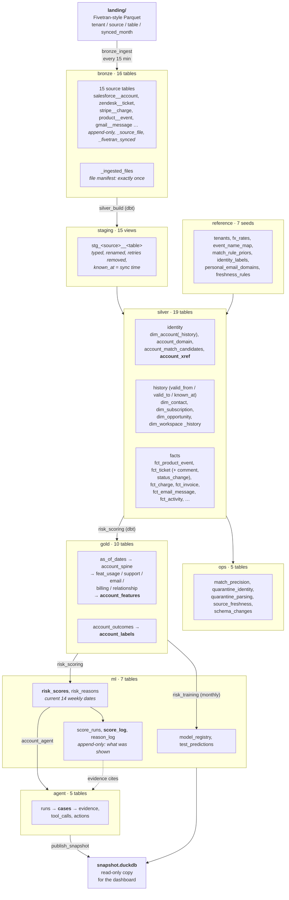
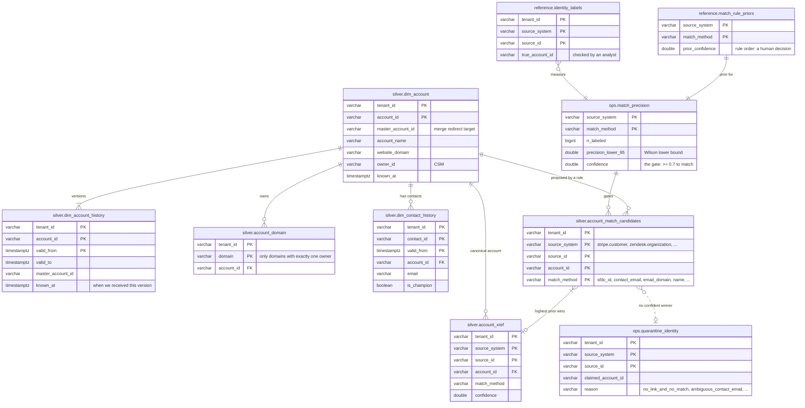
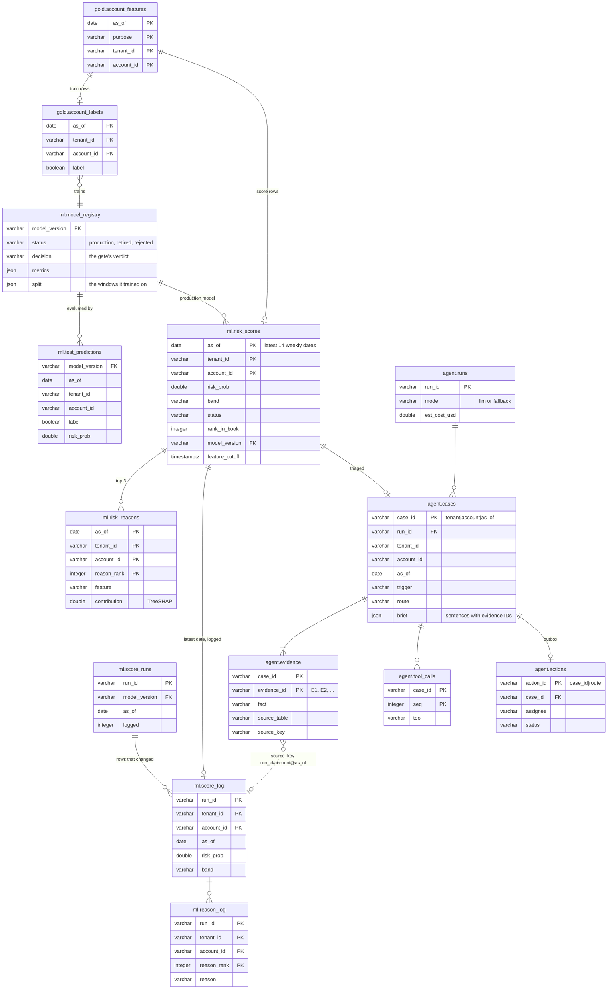

# Warehouse schema

The DuckDB warehouse (`warehouse/warehouse.duckdb`) holds 84 tables and views in eight schemas. This page
is the map: one overview of the layers, then three focused diagrams of the tables a new engineer reads
most. Every column of every dbt model, with its tests and full lineage, is in the generated dbt docs
(see [Browse every model](#browse-every-model-dbt-docs)).

Three keys run through everything:

| Key | Where it starts | What it means |
|---|---|---|
| `tenant_id` + a source ID | bronze | One record in one customer organisation's source system. Source IDs collide across tenants, so `tenant_id` is always part of the key. |
| `tenant_id` + `account_id` | silver (`account_xref`) | One canonical Salesforce account. Every fact is resolved to it, within its tenant only. |
| `as_of` + `tenant_id` + `account_id` | gold | The account as the model saw it on one date, built only from data received by that date. |

## 1. Layers



## 2. Identity: how a source record becomes an account

Every Stripe customer, Zendesk organisation and product workspace is tied to at most one Salesforce
account in its own tenant. Rules propose candidates, a measured confidence gates each rule, a human-set
prior picks the winner, and anything left without a confident winner is quarantined rather than guessed.



`account_xref` is what every fact joins to get its `account_id`. `fct_ticket` also matches a requester's
email to a contact, but only when that email belongs to exactly one account.

## 3. Facts to gold: one row per account per date

Silver facts keep two timestamps: when something happened (`event_time`, `created_at`, `valid_from`) and
when the warehouse received it (`known_at`). Gold reads both, so a feature row for a date only uses what
was known on that date.

```mermaid
erDiagram
    DIM_ACCOUNT["silver.dim_account"] {
        varchar tenant_id PK
        varchar account_id PK
    }
    FCT_PRODUCT_EVENT["silver.fct_product_event"] {
        varchar tenant_id PK
        varchar event_id PK
        varchar account_id FK "via the workspace's xref"
        varchar event_name
        timestamptz event_time
        timestamptz known_at
    }
    FCT_TICKET["silver.fct_ticket"] {
        varchar tenant_id PK
        varchar ticket_id PK
        varchar account_id FK
        varchar priority
        varchar satisfaction_rating
        timestamptz created_at
        timestamptz first_known_at
    }
    FCT_CHARGE["silver.fct_charge"] {
        varchar tenant_id PK
        varchar charge_id PK
        varchar account_id FK
        varchar status
        double amount_usd
        timestamptz created_at
        timestamptz known_at
    }
    FCT_EMAIL_MESSAGE["silver.fct_email_message"] {
        varchar tenant_id PK
        varchar message_id PK
        varchar account_id FK
        varchar direction
        timestamptz sent_at
        timestamptz known_at
    }
    FCT_ACTIVITY["silver.fct_activity"] {
        varchar tenant_id PK
        varchar task_id PK
        varchar account_id FK
        boolean is_save_play
        date activity_date
    }
    DIM_SUBSCRIPTION_HISTORY["silver.dim_subscription_history"] {
        varchar tenant_id PK
        varchar subscription_id PK
        timestamptz valid_from PK
        varchar account_id FK
        bigint seats
        varchar status
        timestamptz known_at
    }
    FCT_OPPORTUNITY_STAGE_CHANGE["silver.fct_opportunity_stage_change"] {
        varchar tenant_id PK
        varchar opportunity_id PK
        timestamptz changed_at PK
        varchar account_id FK
        varchar stage_name
        timestamptz known_at
    }
    AS_OF_DATES["gold.as_of_dates"] {
        date as_of PK
        varchar purpose PK "train: monthly, score: 27 weekly"
        date data_as_of "newest arrival"
    }
    ACCOUNT_SPINE["gold.account_spine"] {
        date as_of PK
        varchar purpose PK
        varchar tenant_id PK
        varchar account_id PK
        varchar owner_id
        bigint tenure_days
        date next_renewal_date
    }
    FEAT_USAGE["gold.feat_usage (and feat_support, feat_email, feat_billing, feat_relationship)"] {
        date as_of PK
        varchar tenant_id PK
        varchar account_id PK
        bigint usage_events_30d
        bigint active_users_30d
        bigint days_since_last_usage
    }
    ACCOUNT_FEATURES["gold.account_features"] {
        date as_of PK
        varchar purpose PK
        varchar tenant_id PK
        varchar account_id PK
        double usage_trend "one of 45 model inputs"
        boolean notice_cancel_scheduled "shown, not a model input"
        timestamptz feature_cutoff "nothing after this is used"
    }
    ACCOUNT_OUTCOMES["gold.account_outcomes"] {
        varchar tenant_id
        varchar account_id
        timestamptz event_at
        varchar event_type "churn, lost renewal, downsell 20%+"
    }
    ACCOUNT_LABELS["gold.account_labels"] {
        date as_of PK
        varchar tenant_id PK
        varchar account_id PK
        boolean label "outcome within 90 days"
        boolean label_complete "the 90 days have passed"
    }

    DIM_ACCOUNT ||--o{ FCT_PRODUCT_EVENT : ""
    DIM_ACCOUNT ||--o{ FCT_TICKET : ""
    DIM_ACCOUNT ||--o{ FCT_CHARGE : ""
    DIM_ACCOUNT ||--o{ FCT_EMAIL_MESSAGE : ""
    DIM_ACCOUNT ||--o{ FCT_ACTIVITY : ""
    DIM_ACCOUNT ||--o{ DIM_SUBSCRIPTION_HISTORY : ""
    DIM_ACCOUNT ||--o{ FCT_OPPORTUNITY_STAGE_CHANGE : ""
    AS_OF_DATES ||--|{ ACCOUNT_SPINE : "live customers on each date"
    ACCOUNT_SPINE ||--|| FEAT_USAGE : "same key"
    FCT_PRODUCT_EVENT }o--o{ FEAT_USAGE : "windows ending at as_of, known_at <= as_of"
    ACCOUNT_SPINE ||--|| ACCOUNT_FEATURES : "joins all five feat_*"
    FEAT_USAGE ||--|| ACCOUNT_FEATURES : ""
    DIM_SUBSCRIPTION_HISTORY }o--o{ ACCOUNT_OUTCOMES : "cancellations, seat drops"
    FCT_OPPORTUNITY_STAGE_CHANGE }o--o{ ACCOUNT_OUTCOMES : "lost renewals"
    ACCOUNT_SPINE ||--o| ACCOUNT_LABELS : "train dates"
    ACCOUNT_OUTCOMES }o--o{ ACCOUNT_LABELS : "next outcome after as_of"
```



The other four feature models follow `feat_usage`'s pattern: `feat_support` reads `fct_ticket`,
`feat_email` reads `fct_email_message`, `feat_billing` reads `fct_charge` and `dim_subscription_history`,
and `feat_relationship` reads `dim_contact_history` and `fct_activity`. `account_spine` also reads
`dim_account_history` (the version known on each date) and `account_outcomes` (to drop accounts already
gone).

## 4. Model and agent: from a feature row to a cited brief

`ml.risk_scores` is the current window, rewritten by every scoring run. `ml.score_log` is the history of
what was shown, and agent evidence points at it, so a brief keeps tracing to the numbers it quoted.



Evidence also points at silver rows (`source_table` + `source_key`: a ticket, a charge, a subscription),
and those carry `_source_file` back to the landed bronze file. The dashboard follows that chain.

## Browse every model (dbt docs)

The diagrams above are curated. For every dbt model's columns, tests and lineage graph, generate the dbt
docs from the running stack and open them locally:

```bash
docker compose exec airflow-scheduler bash -c '$DBT_BIN docs generate --project-dir /opt/airflow/dbt --profiles-dir /opt/airflow/dbt --target-path /opt/airflow/dbt/target'
```

```bash
python3 -m http.server 8081 --directory dbt/target
```

Then open http://localhost:8081. Generate it while the DAGs are idle: it reads the warehouse.
